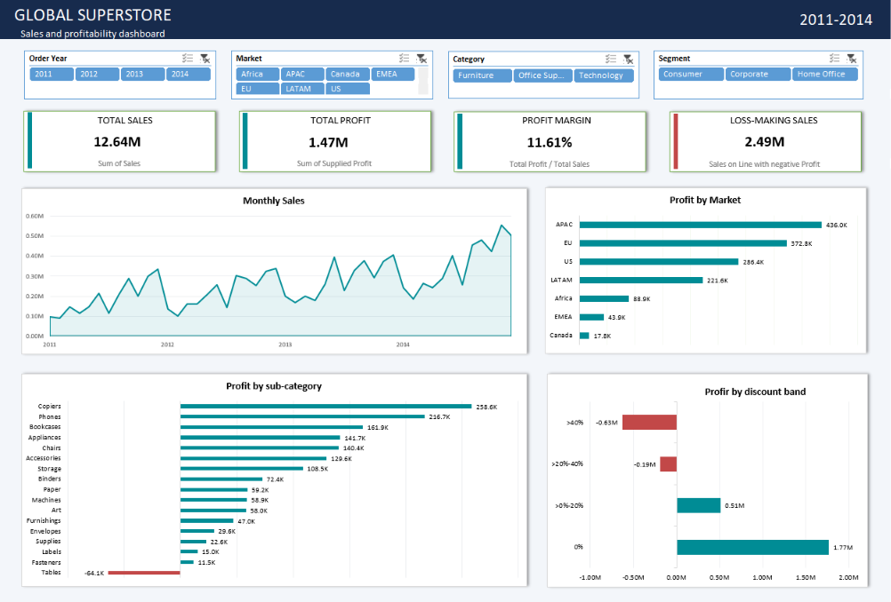

# Global Superstore Sales and Profitability Analysis

I built this Excel project to explore where sales translate into profit and which product areas need closer review. The analysis covers 51,290 product lines from 2011 to 2014, with comparisons across markets, product categories and discount bands.

[Download the workbook](<Workbook/Global Superstore Project.xlsx>)

## Results

| Metric | Total |
| --- | ---: |
| Sales | 12,642,501.91 |
| Profit | 1,467,457.29 |
| Profit margin | 11.61% |
| Sales on loss-making product lines | 2,490,017.62 |

Profit margin is total profit divided by total sales. Sales on loss-making lines measures the revenue from records where profit is negative. Monetary figures use the units supplied in the dataset.

## What I found

- **Furniture needs a closer look.** It generated 4.11 million in sales at a 6.94% profit margin. Within the category, Tables recorded a loss of 64,083.39. I would start by reviewing Tables across markets and discount bands.
- **Higher discounts are associated with losses in this dataset.** Product lines discounted above 40% recorded a combined loss of 627,411.02. This calls for a review of product mix, pricing and costs before changing discount policy.
- **Technology contributed the most profit.** It generated 663,778.73 at a 13.99% margin. Its profitable product and market combinations provide a starting point for further analysis.

## How I built it

1. Imported the workbook data through Power Query, set column types and cleaned text fields.
2. Added Order Year, Month Start, Discount Band, Product Name Clean and Loss Sales columns.
3. Used `SUMIFS`, `COUNTIFS` and `AVERAGEIFS` to compare category performance in an Excel Table.
4. Created five PivotTables and four charts for monthly sales, market profit, sub-category profit and discount-band profit.
5. Connected the Year, Market, Category and Segment slicers to all five PivotTables. Linked the KPI cards using `GETPIVOTDATA` and formatted their display values with `TEXT`.

The Analysis sheet includes seven checks covering record count, sales, profit, loss-making sales, margin, missing postal codes and negative-profit lines. All seven show PASS in the saved workbook.

## Workbook layout

| Sheet | Contents |
| --- | --- |
| Dashboard | KPI cards, charts and interactive slicers |
| Analysis | Reconciliation checks, category formulas and business findings |
| Pivots | Summaries supporting the dashboard |
| Orders | Prepared product-line data in the `tOrders` table |
| Returns and People | Supporting datasets retained in the workbook |

## Using the workbook

Download the file and open the Dashboard sheet in Excel desktop. Use the slicers to compare selections and their clear-filter buttons to return to the full dataset. The Analysis sheet keeps the full-dataset checks and category comparison available for reference.

To refresh the queries, update the source workbook location through **Data > Get Data > Data Source Settings > Change Source**. After the query finishes, refresh the PivotTables and check the totals on Analysis.

## About the data

This is a portfolio project using the historical Global Superstore dataset. Missing postal codes were retained, and negative-profit records were included in the analysis. The findings identify areas for investigation. Discount comparisons describe associations within the data, and the supplied Profit field follows the dataset's definition.

**Author — Rohit Chauhan**
